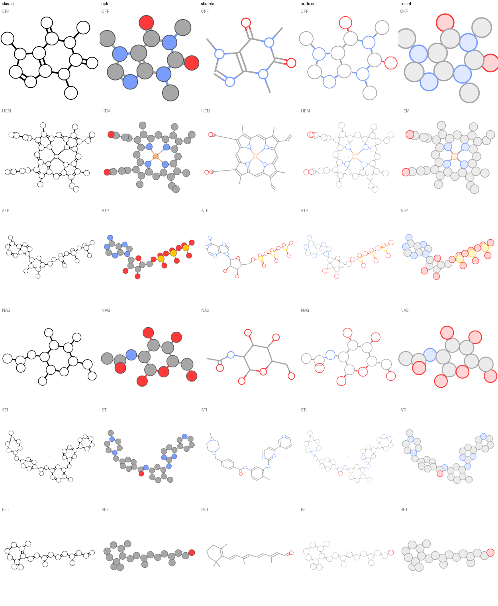

# Vector illustrations of small molecules (prototype, 2026-10-20)

Trial of a workflow for flat, vector-style molecule illustrations: bonds become curves, atoms get camera-facing curve circles, everything is converted to Grease Pencil and exported to SVG. Tested on Blender 5.2.2 with six PDB ligands (CFF, HEM, ATP, NAG, STI, RET) in five styles. Nothing here is wired into `molecularnodes/` yet.



## Files

| File | What it is |
| --- | --- |
| `style_illustration.py` | The `Style Illustration` node group (nodebpy `CustomGeometryGroup`), written to move into `molecularnodes/nodes/geometry/` later |
| `illustrate.py` | Loads CCD ideal ligands (no H, PCA-aligned so rings face the camera), drives a GP object per ligand and renders every style with EEVEE. `uv run docs/dev/illustration/illustrate.py <outdir> [CODE ...]` |
| `export_svg.py` | Runs inside **GUI** Blender: switches a 3D view to the camera and calls `wm.grease_pencil_export_svg` |
| `sheet.py` | Contact sheet of `<CODE>_<style>.png` files |
| `tap.py`, `inspect_gp.py` | Debug helpers: print the geometry at every node output; print evaluated GP strokes, materials and attributes |
| `probes/` | Minimal scripts that isolated each Blender behaviour below |
| `results/renders/` | EEVEE renders and `sheet.png`; `sheet_before_fill_id.png` is the same run before fills worked |
| `results/svg/` | Exported SVGs, their rasterisations (`*_svg.png`), `compare.png` (SVG left, render right), and the `.blend` each was exported from |

Running `export_svg.py` (isolate the user config, it opens a window briefly):

```bash
T=$(mktemp -d); BLENDER_USER_CONFIG=$T/c BLENDER_USER_SCRIPTS=$T/s BLENDER_USER_EXTENSIONS=$T/e \
  /Applications/Blender.app/Contents/MacOS/Blender --factory-startup results/svg/CFF_cpk.blend \
  --python export_svg.py -- out.svg [--uniform]
```

## How the node group works

- Circles: a unit `Curve Circle` instanced on each atom, rotated by the camera's rotation, scaled by `vdw_radii * Atom Scale`. The `Circles` field picks which atoms get one (the skeletal style passes `atomic_number != 6`).
- Bonds: each edge becomes `2 * order` two-point curves (one half per atom, one line per bond order from `bond_type` 2/6 and 3/7). Each half runs from its atom, trimmed to the circle's *projected* edge (`(r + gap) / sin θ`), to the bond midpoint. Zero-length halves are deleted.
- Depth: curves are sorted by camera depth. A bond half sorts just behind its own atom, so circles cover their bonds while nearer atoms' bonds still cross farther atoms. Output uses 2D depth order.
- Colour: stroke, fill and bond colours each mix towards the atom `Color` by a factor; bonds are coloured per half.

## Blender 5.2 behaviour found along the way

1. **A mesh object drops Grease Pencil output.** The molecule evaluates as `MESH` and the GP component is discarded, so the style cannot live in the molecule's own tree. The prototype uses a separate GP object whose modifier does `Object Info(molecule, Relative) -> Style Illustration`. (`probes/probe.py`)
2. **Curves to Grease Pencil:** with *Instances as Layers* on it needs curve instances; with it off it needs plain curves. The wrong one gives zero layers with no warning. (`probes/probe3.py`)
3. **Fills come from the `fill_id` curve attribute, not the material.** `show_fill`/`show_stroke` are ignored for rendering (and deprecated for 6.0); since 5.1 a curve fills only when `fill_id != 0`, and curves sharing an id are triangulated together with even-odd holes. Each circle gets its own id so overlapping circles do not cut holes in each other. (`probes/probe5.py`, `probes/probe6.py`; [5.1 release notes](https://developer.blender.org/docs/release_notes/5.1/grease_pencil/))
4. **EEVEE renders nothing without a World** on the scene. (`probes/probe6.py`; delete its World line to reproduce)
5. **SVG export needs a 3D viewport.** From the `bpy` module (background) it writes a 0x0 SVG (`probes/probe.svg`). In GUI Blender, in camera view, it works and matches the render (`results/svg/compare.png`).
6. **Exported strokes are outline polygons** (`fill=...`, `stroke="none"`), not SVG strokes. `use_uniform_width=True` writes real strokes but at ~0.19 px width, so outlines disappear (`results/svg/CFF_cpk_uniform_svg.png`).

## Writing SVG ourselves

Points 5 and 6 argue for exporting from Python. The hard parts are not XML: projecting points through the camera (`bpy_extras.object_utils.world_to_camera_view`), converting world radii to page units, linear-to-sRGB colour, and keeping draw order. Because the node group knows what every stroke means, a custom exporter can write real `<circle>` and `<line>` elements with true `stroke`/`fill`, which are smaller and editable in Illustrator/Inkscape, and it runs headless in CI.

Library options for the XML part, checked 2026-10-20:

| Library | Latest | Deps | Notes |
| --- | --- | --- | --- |
| stdlib `xml.etree.ElementTree` | - | none | Enough for `svg`, `g`, `circle`, `line`, `path`. Nothing to bundle in the extension |
| [svg.py](https://pypi.org/project/svg.py/) | 1.10.0 (Dec 2025) | none, MIT | Typed dataclasses named after SVG elements/attributes; the smallest real library |
| [drawsvg](https://pypi.org/project/drawsvg/) | 2.4.2 (Aug 2026) | none required, MIT | Larger: animation, Jupyter display, raster output via optional extras and Cairo |
| [svgwrite](https://pypi.org/project/svgwrite/) | 1.4.3 (2022) | none, MIT | Marked inactive on PyPI, bugfixes only. Avoid |

## Known limitations

- Double bonds are offset symmetrically, not drawn inside the ring as in textbook figures. Aromatic bond type 9 draws as single.
- Circles face the camera's direction, exact for orthographic, slightly off at the frame edges in perspective.
- `illustrate.py` recolours carbons grey; MN's default colours carbons per chain.
- A tiny dot appears at the image centre in every render; source not tracked down.
